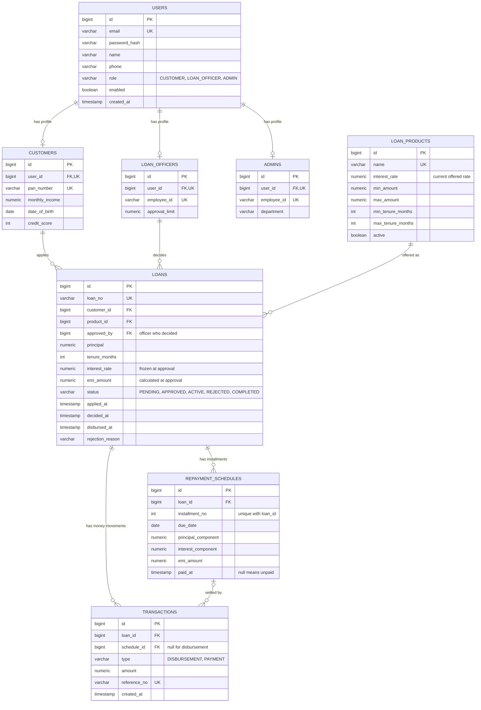
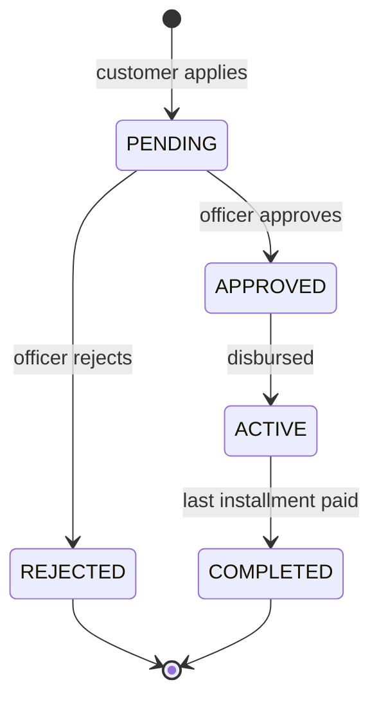

# Loan Management System

A role-based REST backend for a bank-style loan workflow. Customers apply for loans, loan officers approve and disburse them, and the system generates the EMI schedule, accepts payments safely, tracks overdue installments and emails customers about decisions.

## Features

- **Authentication and authorization:** stateless JWT login, BCrypt password hashing, role checks with `@PreAuthorize`, and ownership checks so customers only see their own loans.
- **Loan products:** admins manage a catalogue of loan types with interest rate, amount limits and tenure limits. Products are deactivated, never deleted.
- **Loan application:** customers apply against an active product. The request is validated against the product limits and an affordability rule (EMI must not exceed 50% of monthly income).
- **Approval workflow:** officers approve or reject pending applications. Approval enforces the officer's approval limit and fixes the interest rate and EMI on the loan. Rejection requires a reason.
- **Disbursement:** releasing an approved loan creates a disbursement transaction, generates the full repayment schedule and activates the loan, all in one transaction.
- **EMI calculation:** reducing-balance amortization using `BigDecimal`. The last installment absorbs rounding so principal sums exactly to the loan amount.
- **Payments:** customers pay the next unpaid installment. Payments are idempotent through a client-supplied reference, so retried requests never charge twice. The loan completes after the final installment.
- **Overdue tracking:** staff can list overdue installments and see a summary. A scheduled job logs a daily summary.
- **Email notifications:** customers receive an email when a loan is approved or rejected. Emails are sent after the transaction commits, asynchronously, and a mail failure never undoes a decision.
- **Consistent errors:** a global exception handler returns the same JSON error shape for validation errors, missing resources, duplicates, business rule violations and access denial.

## Tools & Technologies Used

**Spring Boot:** Framework used for building RESTful APIs and managing application configuration.

**PostgreSQL:** Relational database used to store and manage application data.

**SMTP:** Protocol used for sending email notifications regarding loan application status updates.

**JWT (JSON Web Token):** Used for secure user authentication and authorization.

**Postman:** Tool used for API testing and validation.

**GitHub:** Platform used for version control and project collaboration.

## Database design

Eight tables in PostgreSQL, managed entirely by Flyway migrations. Hibernate only validates the schema (`ddl-auto=validate`) and never changes it.

**Why it is shaped this way**

- **Shared login data lives once.** `users` holds credentials and role. Role-specific data lives in `customers`, `loan_officers` and `admins`, each linked one-to-one by a unique `user_id`. No customer-only columns sit empty on staff rows.
- **`loan_products` stores facts once** (name, limits, tenure range). A loan references it by `product_id`.
- **The interest rate appears in two tables on purpose.** `loan_products.interest_rate` is the rate currently offered to new applicants. `loans.interest_rate` is the contractual rate, copied when the loan is approved. Changing a product's rate never changes existing loans.
- **The full schedule is stored at disbursement.** Next EMI due, overdue installments and outstanding balance become simple queries.
- **Derived values are not stored.** Whether an installment is overdue comes from `paid_at` and `due_date`, so there is no flag to fall out of sync.
- **Enums are stored as strings** with database `CHECK` constraints, so invalid values are rejected at both the Java and database level.
- **Money is `NUMERIC(15,2)` in the database and `BigDecimal` in Java.** Never floating point.

## Roles and access

| Role | Can do |
|---|---|
| `CUSTOMER` | Register, apply for loans, view own loans, schedules and transactions, pay EMIs |
| `LOAN_OFFICER` | List pending applications, approve, reject, disburse, view any loan, view overdue installments |
| `ADMIN` | Create loan officers, manage loan products, view any loan, view overdue installments |

Access is enforced in two layers. A role check (`@PreAuthorize`) decides who may call an endpoint, and an ownership check in the service decides which records a customer may see. A customer requesting someone else's loan receives `404`, so loan ids are not revealed.

Customers can only self-register. Loan officers are created by an admin, and the first admin is seeded from environment variables at startup.

## Loan lifecycle

